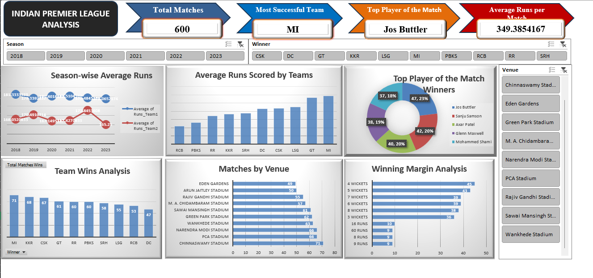

# 🏏 IPL Match Performance Analysis & Insights Dashboard

An interactive **Microsoft Excel dashboard** that analyses Indian Premier League (IPL) match data across seasons 2018–2023. It uses PivotTables, charts, and slicers to surface team performance, top players, venue trends, and winning margins in a single view.



---

## 📌 Project Overview

The goal of this project is to turn raw IPL match records into clear, decision-ready insights. Starting from a dataset of 600 matches, the workbook builds a set of summary tables and visuals that can be filtered by **Season**, **Winning Team**, and **Venue**.

### Key Metrics (KPI Cards)

| KPI | Value |
|-----|-------|
| Total Matches | 600 |
| Most Successful Team | MI (Mumbai Indians) |
| Top Player of the Match | Jos Buttler |
| Average Runs per Match | ~349.39 |

---

## 📁 Repository Contents

| File | Description |
|------|-------------|
| `IPL Match Performance Analysis & Insights Dashboard.xlsx` | Excel workbook containing the dataset, PivotTables, charts, and the final dashboard |
| `dashboard.png` | Screenshot of the finished dashboard |
| `README.md` | Project documentation |

---

## 🗂️ Dataset

The raw data lives in `Sheet1` of the workbook (600 rows × 14 columns).

| Column | Description |
|--------|-------------|
| Season | IPL season (2018 – 2023) |
| Match_ID | Unique match identifier |
| Date | Date of the match |
| Venue | Stadium where the match was played |
| Team1 / Team2 | The two competing teams |
| Winner | Winning team |
| Margin | Winning margin (runs or wickets) |
| Player_of_Match | Player awarded Player of the Match |
| Runs_Team1 / Runs_Team2 | Runs scored by each team |
| Wickets_Team1 / Wickets_Team2 | Wickets lost by each team |
| Total_Runs | Calculated column: `Runs_Team1 + Runs_Team2` |

**Teams covered:** MI, CSK, KKR, RCB, DC, PBKS, RR, SRH, GT, LSG

---

## 📊 Workbook Structure

| Sheet | Purpose |
|-------|---------|
| `Sheet1` | Raw match dataset |
| `Sheet2` | Practice formulas / analysis questions (COUNT, COUNTIF, MAX, IF, YEAR) |
| `Season Performance Summary` | Average runs by season for Team 1 and Team 2 |
| `Team Wins Analysis` | Total wins per team |
| `Team Batting Performance` | Average runs scored by each team |
| `Player of the Match Leaders` | Count of Player of the Match awards |
| `Matches by Venue` | Number of matches hosted per stadium |
| `Winning Margin Analysis` | Distribution of winning margins |
| `Total Runs` | Average total runs per match |
| `Charts` / `Dashboard` | Final visuals and the consolidated dashboard |

---

## 📈 Dashboard Visuals

- **Season-wise Average Runs** – line chart comparing average runs of Team 1 vs Team 2 across seasons
- **Average Runs Scored by Teams** – column chart ranking teams by batting output
- **Top Player of the Match Winners** – donut chart of the most-awarded players (Jos Buttler, Sanju Samson, Axar Patel, Glenn Maxwell, Mohammed Shami)
- **Team Wins Analysis** – column chart of total wins per team (MI leads with 71)
- **Matches by Venue** – bar chart of matches played at each stadium
- **Winning Margin Analysis** – bar chart of the most common win margins
- **Interactive Slicers** – filter the dashboard by Season, Winner, and Venue

---

## 🔍 Key Insights

- **Mumbai Indians (MI)** have the most wins in the dataset (71), followed by KKR (68) and CSK (67).
- **Jos Buttler** has the most Player of the Match awards (47), closely followed by Sanju Samson (42) and Axar Patel (40).
- **Chinnaswamy Stadium** hosted the most matches (71), followed by PCA Stadium and Narendra Modi Stadium (66 each).
- **4-wicket and 5-wicket wins** are the most frequent winning margins.
- MI and GT record the highest average runs among the teams.

---

## 🛠️ Tools & Techniques

- **Microsoft Excel**
- **PivotTables & PivotCharts**
- **Slicers** for interactive filtering
- **Formulas:** `COUNT`, `COUNTIF`, `MAX`, `IF`, `YEAR`
- **Dashboard design:** KPI cards, formatted charts, consistent layout

---

## 🚀 How to Use

1. Clone or download this repository:
   ```bash
   git clone https://github.com/vishwanathzore4-png/IPL-Match-Performance-Analysis-Insights-Dashboard.git
   ```
2. Open `IPL Match Performance Analysis & Insights Dashboard.xlsx` in **Microsoft Excel** (2013 or later recommended, for slicer support).
3. Go to the **Dashboard** sheet.
4. Use the **Season**, **Winner**, and **Venue** slicers to explore the data.

> **Note:** Slicers and PivotTables may not render correctly in Google Sheets or LibreOffice. Use desktop Excel for the full experience.

---

## 🔮 Future Improvements

- Add batting and bowling statistics at player level
- Include toss decision and toss winner analysis
- Build an equivalent dashboard in Power BI or Tableau
- Extend the dataset to earlier seasons (2008–2017)

---

## 👤 Author

**Vishwanath Zore**
GitHub: [@vishwanathzore4-png](https://github.com/vishwanathzore4-png)

---

⭐ If you found this project useful, consider giving it a star!
